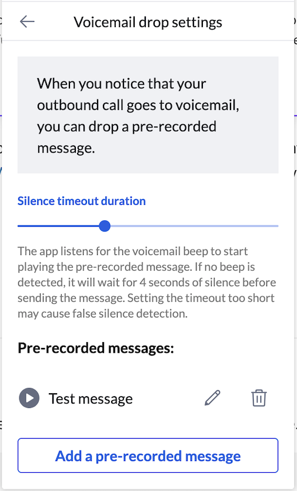
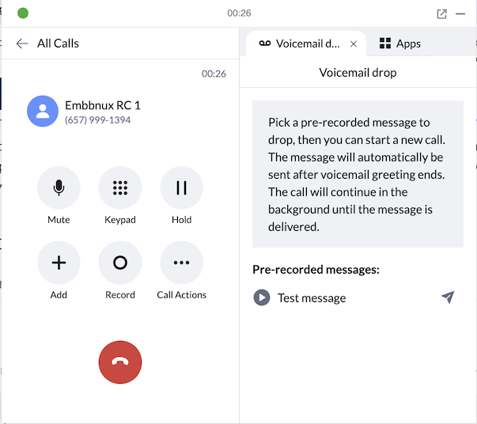

# Voicemail Drop (Beta)

<!-- md:version 3.0.0 -->

Voicemail Drop allows users to automatically leave a pre-recorded message when an outbound call reaches voicemail.

On RingEX calls, users don’t have to wait for the voicemail recording to finish — they can immediately start the next call instead. Voicemail drop also works on [RingCX calls](#voicemail-drop-on-ringcx-calls-experimental), where the agent stays on the call until the message ends.

## Enable Voicemail Drop

To enable Voicemail Drop, you need to set `enableVoicemailDrop` and `enableSideWidget` flag into the widget's URI.

=== "Javascript"

    ```js
    <script>
      (function() {
        var rcs = document.createElement("script");
        rcs.src = "https://apps.ringcentral.com/integration/ringcentral-embeddable/3.x/adapter.js?enableSideWidget=1&enableVoicemailDrop=1";
        var rcs0 = document.getElementsByTagName("script")[0];
        rcs0.parentNode.insertBefore(rcs, rcs0);
      })();
    </script>
    ```

=== "iframe"

    ```html
    <iframe width="300" height="500" id="rc-widget" allow="microphone" 
      src="https://apps.ringcentral.com/integration/ringcentral-embeddable/3.x/app.html?enableSideWidget=1&enableVoicemailDrop=1">
    </iframe>
    ```

After enabled, user can get voicemail drop settings in "Settings > Advanced -> Voicemail drop" page.



After pre-recorded messages added, user will get voicemail drop button in call actions. User can select one of the pre-recorded messages to leave.



The message plays automatically when the voicemail greeting ends. If no greeting end is detected within 45 seconds, the message is not dropped and the call ends.

## RingEX and RingCX calls

| | RingEX call | RingCX call |
| --- | --- | --- |
| Status | Beta | Experimental |
| Calls | Outbound | Outbound |
| After **Drop** | The widget goes to the dialer. The call keeps playing the message in the background. | The agent stays on the call page, which shows the drop's progress. |
| Next call | Can be started right away. | Can be started once the message ends and the call is dispositioned. RingCX keeps the agent engaged on the call until then. |
| Talk to the caller during the drop | No | Yes, with **Take over** |
| When the message ends | The call hangs up. | The call hangs up, and the agent finishes the disposition. |

## Voicemail drop on RingCX calls (Experimental)

<!-- md:version 3.1.0 -->

Voicemail drop on [RingCX](../integration/ringcx.md) calls needs `enableRingCX=1` as well, and the agent's voice connection must be the integrated softphone. The message plays on the agent's own line, so the agent stays on the call while it plays:

- The agent's microphone is muted during the drop, but the agent still hears the call, including the greeting and beep.
- The call page shows the progress: an elapsed timer while waiting for the greeting to end, then a bar with the played and total time of the message.
- Mute, keypad, hold, transfer and recording are disabled during the drop. **End call** stays available.
- If a person answers, **Take over** stops the message and gives the call back to the agent, with the microphone as it was before the drop.
- When the drop starts, the disposition opens in the side panel if the call needs one, so the agent can fill it in while the message plays.
- For campaigns that hang up on disposition, **Submit and hang up** is disabled until the message ends.
- When the message ends, the call hangs up. The agent submits the disposition and can then take the next call.

## Voicemail drop event

The widget sends `rc-call-drop-voicemail-notify` each time a drop's status changes. `call.voicemailDropStatus` is one of:

| Status | Meaning |
| --- | --- |
| `webphone-voicemail-drop-waitingForGreetingEnd` | Waiting for the voicemail greeting to end. |
| `webphone-voicemail-drop-sending` | The message is playing. |
| `webphone-voicemail-drop-finished` | The message was dropped. |
| `webphone-voicemail-drop-greetingDetectionFailed` | No greeting end was detected, so the message was not dropped. |
| `webphone-voicemail-drop-terminated` | The call ended before the message finished. |
| `webphone-voicemail-drop-cancelled` | The drop was stopped: the agent took over or the RingCX call ended during the drop. RingCX calls only. |

For a RingEX call, `call` is the webphone session. For a RingCX call, `call` is the RingCX call: `call.source` is `'ringcx'` and `call.id` is the RingCX call `uii`. The RingEX line that carries the RingCX audio is not reported.

```js
window.addEventListener('message', (e) => {
  const data = e.data;
  if (data && data.type === 'rc-call-drop-voicemail-notify') {
    console.log(data.call.source, data.call.id, data.call.voicemailDropStatus);
  }
});
```

## Online demo

[Voicemail drop online demo](https://apps.ringcentral.com/integration/ringcentral-embeddable/3.x/index.html){ .md-button .md-button--primary }